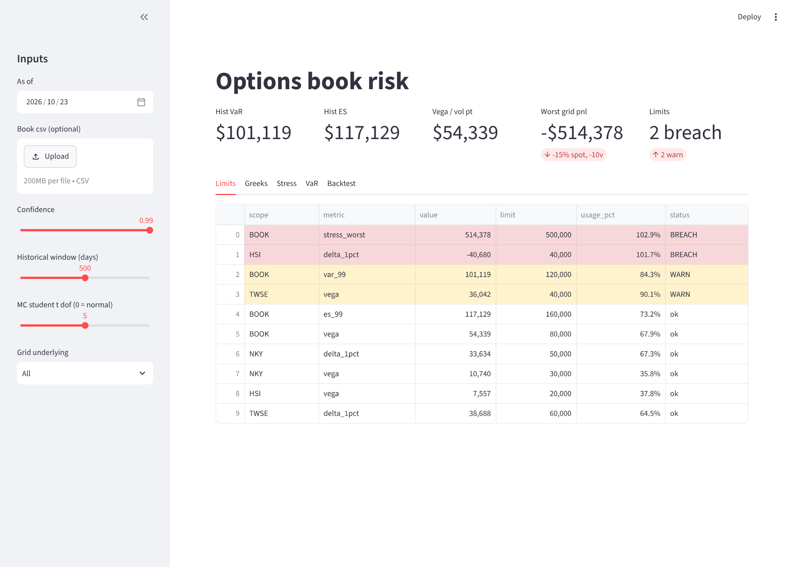
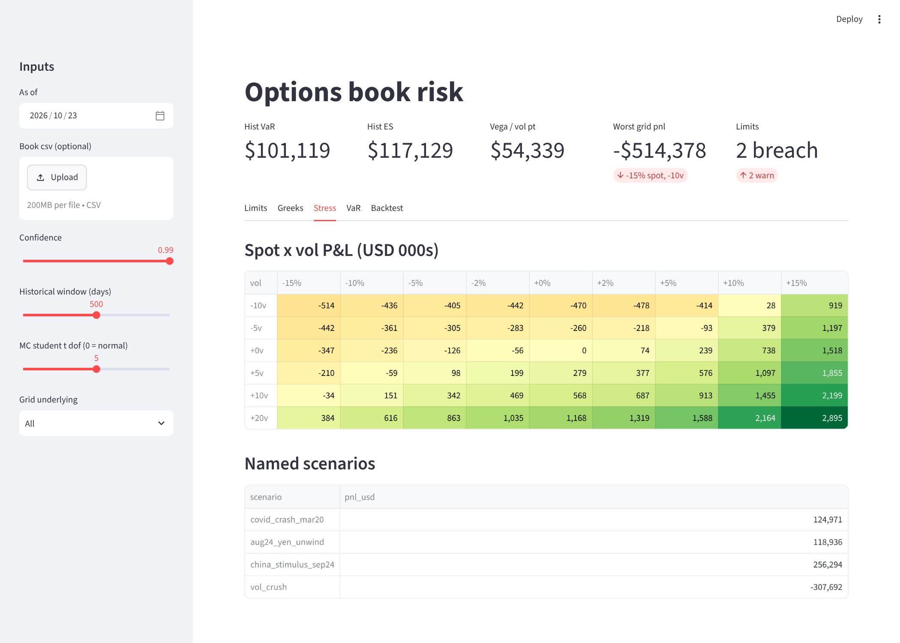
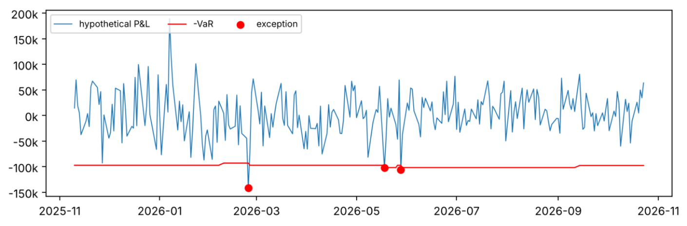
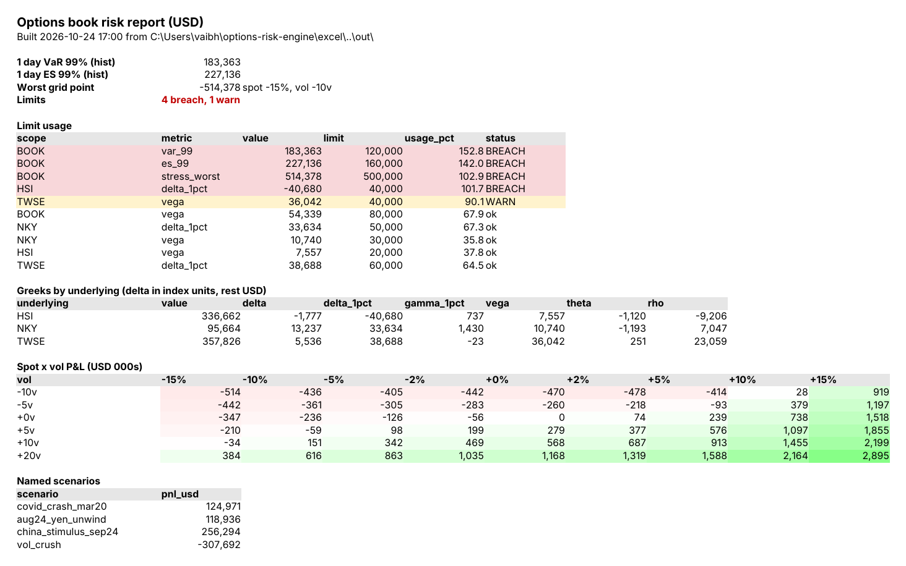

# options-risk-engine

A small market risk engine for an options market making book. I built it to understand what a risk analyst at a market maker actually looks at every morning: the greeks, how the book behaves when spot and vol move together, VaR and whether that VaR can be trusted, and which limits are close to being hit.

The sample book is synthetic: 27 lines of index options and futures hedges on NKY, HSI and TWSE across four expiries, with a skew baked into the vols. Market history is also synthetic (GARCH(1,1) with correlated student t shocks, see `data/make_history.py`) so I could commit it without vendor data.



## What it does

**Pricing and greeks** (`riskengine/pricing.py`)
Black Scholes Merton with dividend yield, vectorised over the whole book. Delta, gamma, vega (per vol point), theta (per day) and rho, all checked against finite difference bumps in the tests.

**Aggregation** (`riskengine/portfolio.py`)
Position greeks scaled by qty, multiplier and FX so everything sums in USD. Rolled up by underlying and by underlying x expiry. Cash delta and gamma are shown for a 1% move since that is easier to reason about than raw delta across three different index levels.

**Stress** (`riskengine/scenarios.py`)
Full revaluation spot x vol grid (spot -15% to +15%, vol -10 to +20 points) plus a few named scenarios loosely shaped on real moves (Mar 2020, the Aug 2024 yen carry unwind, the Sep 2024 China stimulus rally, a vol crush).



**VaR and ES** (`riskengine/var.py`)
* historical simulation, full reval of the book under each of the last 500 days of spot and vol moves
* Monte Carlo with an EWMA covariance (lambda 0.94) over spot and vol jointly, normal or student t shocks
* delta normal as a sanity check, the gap between this and the full reval numbers is roughly the convexity in the book

**Backtesting** (`riskengine/backtest.py`)
Rolling 250 day backtest of 1 day 99% historical VaR against hypothetical P&L, with the Kupiec proportion of failures test, the Christoffersen independence test (are exceptions clustering?) and the Basel traffic light zone.



**Limits** (`riskengine/limits.py`)
Book and per underlying limits from `data/limits.json`, warn at 80% usage, breach above 100%.

**Excel / VBA** (`excel/`)
A lot of risk reporting still ends up in Excel, so there is a VBA side too. `BlackScholes.bas` adds Black-Scholes worksheet functions (`=BS_DELTA(...)` etc.) and `MorningReport.bas` has two macros: one turns the Python output into a one page report with breaches highlighted and the stress grid as a heat map, the other loads the book with live greek formulas for quick what-ifs. Both are tested against the Python engine (see `excel/README.md`).



## Running it

```
pip install -r requirements.txt
python -m pytest
python -m riskengine.report          # prints the morning report, writes csvs to out/
python data/fetch_history.py         # optional: real index history, needs yfinance
streamlit run app.py                 # dashboard
python excel/tests/test_vba.py       # vba checks, needs LibreOffice
```

`report` exits with code 1 if any limit is in breach, so it could sit in a cron job and alert.

Sample output on the included book:

```
VaR / ES (1 day)
          historical  monte_carlo_t5
VaR 99%     101,119          83,358
ES 99%      117,129         110,925

backtest (last 250d) {'days': 250, 'exceptions': 3, 'expected': 2.5, 'kupiec_p': 0.758, 'basel_zone': 'green'}

limits
 scope       metric   value  limit  usage_pct status
 BOOK stress_worst 514,378 500000        103 BREACH
  HSI   delta_1pct -40,680  40000        102 BREACH
 BOOK       var_99 101,119 120000         84   WARN
 TWSE         vega  36,042  40000         90   WARN
```

The grid shows the book is long vol overall but loses in the low vol / spot down corner, which is the stress limit breach.

## On real history

`data/fetch_history.py` pulls three years of real Nikkei 225, Hang Seng and TAIEX closes from Yahoo and writes them in the same format as the synthetic files. Vol moves are proxied by the change in 21 day EWMA realised vol, since I couldn't find free implied vol history for all three that lines up (more on that in the script's docstring).

```
python data/fetch_history.py
python -m riskengine.report --returns data/returns_real.csv --vols data/vol_changes_real.csv
```

That gave 633 common trading days (Nov 2023 to Oct 2026), and the same book looks a lot worse:

```
VaR / ES (1 day)
          historical  monte_carlo_t5
VaR 99%     183,363         267,956
ES 99%      227,136         349,457

backtest (last 250d) {'days': 250, 'exceptions': 6, 'expected': 2.5, 'kupiec_lr': 3.555, 'kupiec_p': 0.059, 'independence_p': 0.12, 'basel_zone': 'yellow'}
```

What I take from it:

* Historical VaR goes from 101k to 183k, so the book is now over its 120k VaR limit and its ES limit, not just warning. The synthetic GARCH data was simply calmer than the real markets.
* The backtest is the more interesting part. 6 exceptions against 2.5 expected puts the model in the Basel yellow zone. Kupiec only just fails to reject at 5% (p = 0.059), so I wouldn't call the model broken, but I wouldn't call it fine either. The independence test (p = 0.12) doesn't show the exceptions clustering.
* On synthetic data Monte Carlo came in below historical. On real data it comes in well above. The EWMA covariance weights recent days heavily, so my reading is that recent vol has been higher than the three year average that historical simulation spreads its weight over.
* Real spot/vol correlation is weaker than the synthetic generator assumed (between -0.11 and -0.29 against -0.35), but the vol proxy is realised vol, so I'd be careful reading much into that.

The synthetic files are still the default so the repo runs without a network connection.

## Things I simplified

* vol moves are parallel shifts of each underlying's smile, no skew or term structure moves
* the backtest replays historical moves on today's book (hypothetical P&L), not actual P&L with intraday trading
* no early exercise, everything is priced European
* rates and dividends are flat per underlying

Next I'd like to add sticky strike vs sticky delta vol dynamics and a proper vol surface per underlying (see my vol-surface-svi repo).

---

If something here is unclear, broken, or just wrong, feel free to open an issue. I'm always happy to chat about it.
